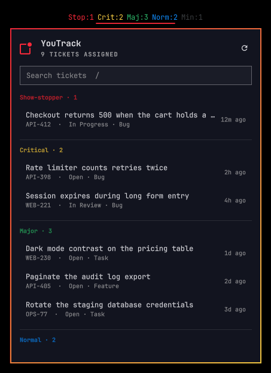

# YouTrack for Omarchy

An Omarchy bar widget that shows the [YouTrack](https://www.jetbrains.com/youtrack/)
tickets assigned to you, counted by priority.

The bar shows one `<priority>:<count>` pair per priority that has open tickets,
e.g. `P0:1 P1:4 P2:7` or `Crit:1 Maj:4 Norm:7`. The pill takes the theme's
urgent color while anything of the top priority is open, and reads `YT!` when the lookup fails. Clicking it opens a popup listing
the same tickets under a heading per priority, newest update first, with a
search box that can also query all of YouTrack.

Works with YouTrack Cloud and self-hosted YouTrack.



## Requirements

- Omarchy with the plugin shell
- `curl` and `jq`
- A YouTrack permanent token

## Install

```bash
omarchy plugin add https://github.com/ahiggins1039/omarchy-youtrack
omarchy plugin enable ahiggins1039.youtrack right
```

Then set up your credentials (below). Until you do, the bar reads `YT!` and its
tooltip says what is missing.

## Credentials

1. In YouTrack, open your profile → **Account Security** → **Tokens** →
   **New token**, and give it the YouTrack scope.
2. Create `~/.config/omarchy/youtrack.env` and make it readable only by you:

   ```bash
   install -m 600 /dev/null ~/.config/omarchy/youtrack.env
   ```

3. Put your instance URL and token in it:

   ```sh
   YOUTRACK_URL="https://example.youtrack.cloud"
   YOUTRACK_TOKEN="perm:..."
   # Optional; the widget's own settings override these.
   YOUTRACK_QUERY="for: me #Unresolved"
   YOUTRACK_PRIORITY_FIELD="Priority"
   ```

   For self-hosted instances, use the URL you open YouTrack at, e.g.
   `https://youtrack.example.com` or `https://example.com/youtrack`.

Set `YOUTRACK_CONFIG` to use a different file.

To try the widget before creating a token, put `YOUTRACK_DEMO=1` in the file
instead. It then shows made-up tickets and never contacts YouTrack; remove the
line once your real credentials are in.

> **Note:** the file is loaded with bash's `source`, so it runs as a shell
> script every time the widget refreshes. Keep it to plain `NAME="value"` lines
> and don't let anyone else write to it.

The token is only ever sent to `YOUTRACK_URL`. The widget makes no other network
requests.

## Interactions

| Input | Action |
|---|---|
| Left click | Open/close the popup |
| Right click | Refresh now |
| Middle click | Open the query in YouTrack |
| `↑` / `↓` in the popup | Move the cursor over tickets |
| `Enter` | Open the highlighted ticket in the browser |
| `/` or click the search box | Search the list |
| `Shift+Enter` in the search box | Search all of YouTrack |
| `r` | Refresh |
| `Esc` | Close |

## Search

The box at the top of the popup filters the listed tickets as you type. Every
word has to match somewhere in the ticket's id, summary, priority, state, type,
or project, case-insensitively, so `p1 bug` narrows to P1 bugs and `abc-12`
finds a ticket by id. The bar counts always cover the full query.

While the box has focus, `↑` / `↓` move through the matches (the top one is
highlighted as you type), `Enter` opens the highlighted ticket, and `Esc`
clears the search, or closes the popup if it is already empty. The search is
reset each time the popup opens.

### Searching YouTrack itself

To look beyond your own tickets, press `Shift+Enter` (or plain `Enter` when
nothing assigned matches), or click the "Search all of YouTrack" row under the
list. The box's text is then sent to YouTrack as the query itself, so it can be
plain words (a full-text search across every project, resolved tickets
included) or full query syntax such as `project: ABC #Unresolved Type: Bug`.
The results replace the list, grouped by priority as usual, and the bar is
left alone.

Editing the text drops back to filtering your own tickets until you search
again; typing it back to exactly what was searched brings the last results
back without asking YouTrack again. With YouTrack's results showing,
`Shift+Enter` or the row opens the same search in the browser. A query YouTrack
cannot parse shows its error in place of the results.

## Settings

Per-widget settings live in the widget's entry in `~/.config/omarchy/shell.json`
and override `YOUTRACK_QUERY`:

- `query` — any YouTrack search (default `for: me #Unresolved`)
- `refreshIntervalSec` — poll interval, minimum 30 (default 300)
- `emptyLabel` — bar text when nothing matches (default `YT:0`)
- `priorityField` — the custom field tickets are grouped by (default
  `YOUTRACK_PRIORITY_FIELD`, else `Priority`)
- `priorities` — your own priority order, most urgent first (see below)

`#Unresolved` is about the resolved flag, not the workflow state, so states
such as `Released` still count. To leave them out:

```
for: me #Unresolved State: -Released
```

At most 500 tickets are fetched per query.

## Priorities and colors

Tickets are grouped by their `Priority` field, or whichever field
`priorityField` names. Out of the box the widget recognises two scales, so most
projects need no configuration:

| Rank | P-levels | YouTrack defaults | Bar label | Palette role | Falls back to |
|---|---|---|---|---|---|
| 1 | P0 | Show-stopper | `P0` / `Stop` | `red` / `color1` | the bar's urgent color |
| 2 | P1 | Critical | `P1` / `Crit` | `yellow` / `color3` / `orange` | the theme accent |
| 3 | P2 | Major | `P2` / `Maj` | `green` / `color2` | the theme accent |
| 4 | P3 | Normal | `P3` / `Norm` | `blue` / `color4` / `cyan` | the theme accent |
| 5 | P4 | Minor | `P4` / `Min` | `muted` / `color8` / `dark_foreground` | `Color.muted` |

Names are matched case-insensitively. The bar uses the short label, and the
popup and tooltip use the full name. Anything of rank 1 turns the pill urgent.

If your project uses other names, list them in the `priorities` setting, most
urgent first, comma-separated. Add `=Label` to give one a shorter bar label:

```
Urgent=U, High=H, Medium=M, Low=L
```

A custom list replaces the built-in scales. Its first five entries take the
colors above, and any after that are gray.

Priorities that aren't on the scale are still counted and listed, after the
known ones in alphabetical order, in the surrounding foreground color. A ticket
with no priority is grouped under `None`; if every ticket lands there, check
the field name.

`colors.toml` is watched, and re-read whenever the shell's own palette changes,
so a theme switch repaints the widget without a restart.

## Troubleshooting

`youtrack-fetch` is a standalone script. Run it in a terminal to see exactly
what the widget sees, including any error:

```bash
~/.config/omarchy/plugins/ahiggins1039.youtrack/youtrack-fetch
```

## Uninstall

```bash
omarchy plugin disable ahiggins1039.youtrack
omarchy plugin remove ahiggins1039.youtrack
rm ~/.config/omarchy/youtrack.env
```

## Development

`Model.js` holds the grouping, priority scale, label, and formatting logic, with
tests in `tests/` (`node --test tests/`); `Panel.qml` is the
bar pill plus the popup; `youtrack-fetch` talks to the YouTrack REST API.

Saving `Model.js` or `Panel.qml` reloads the plugin registry, but the widget
already in the bar keeps running the previously compiled QML, so run
`omarchy restart shell` to see changes. Changes to `youtrack-fetch` take effect
on the next refresh.

After cloning, enable the pre-commit hook that blocks env files and tokens from
being committed:

```bash
git config core.hooksPath .githooks
```

## License

[MIT](LICENSE)
